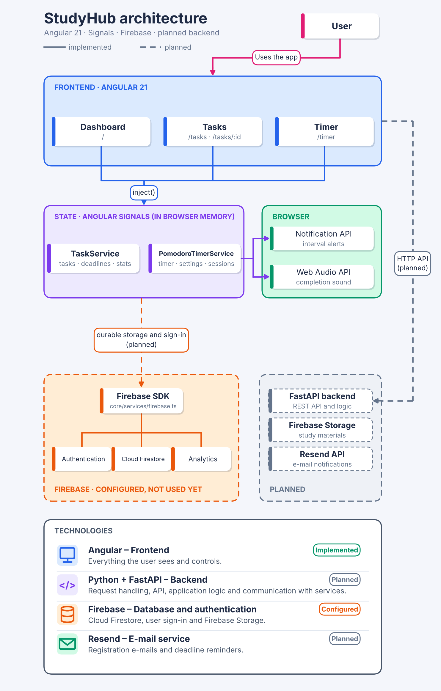

# StudyHub

**Plan your study. Find your focus. See your progress.**

StudyHub is a responsive student study planner built with Angular. It brings
upcoming tasks, focused study sessions, and useful progress summaries into one
dark-themed workspace.

## What you can do

### Dashboard

- See active subjects, tasks due today, upcoming deadlines, and tasks completed
  this week.
- Review upcoming tasks and mark them complete or reopen them.
- Add study tasks with a subject, description, and deadline.
- Check your study time for each day of the current week.
- Start and control a compact Pomodoro timer without leaving the dashboard.

### Tasks

- Browse tasks ordered by completion status and deadline.
- Open a task to edit its subject, description, or deadline.
- Mark a task complete, reopen it, or delete it.
- See task deadlines in a readable date and time format.

### Focus timer

Open **Timer** from the shared sidebar or visit `/timer`. The dedicated timer
workspace includes:

- A focus and break timer with start, pause, continue, reset, and skip controls.
- Editable subject and task labels for the current session.
- A visual progress indicator toward the next long break.
- Custom focus, short-break, and long-break durations, plus the number of focus
  intervals before a long break.
- Optional completion sounds and browser notifications.
- Daily, weekly, and monthly completed focus-time totals.
- A chart of study time by weekday.
- Recent completed sessions and a breakdown of focus time by subject.

The default cycle is **25 minutes of focus**, a **5-minute short break**, and a
**15-minute long break after four completed focus intervals**. Focus durations
can be set from 1–180 minutes, short breaks from 1–60 minutes, long breaks from
1–120 minutes, and long breaks can follow 2–12 completed focus intervals.

Only completed focus intervals count toward study statistics. Sessions without
a subject are grouped under **Unassigned subject**.

## Pages and navigation

| URL | Page |
| --- | --- |
| `/` | Dashboard |
| `/tasks` | Task list |
| `/tasks/:id` | Task details and editing |
| `/timer` | Full Pomodoro workspace |

The sidebar is shared across the dashboard and timer pages, with matching
desktop and mobile layouts. Subjects, Calendar, and Settings are currently
navigation placeholders rather than separate implemented pages.

## Data and privacy

Tasks, timer settings, and completed focus sessions are currently held in
browser memory. They are **not saved between page reloads**; refreshing the
application clears them. Browser notifications require the browser's
permission, and completion sound requires browser audio support.

## Architecture



*(Slovak version: [docs/architecture.sk.png](docs/architecture.sk.png).)*

Today StudyHub is a client-side Angular application. The three pages
(Dashboard, Tasks, Timer) read and write state through two root-provided
services built on Angular Signals:

- `TaskService` – tasks, deadlines, and derived dashboard figures
  (active subjects, due today, upcoming, completed this week).
- `PomodoroTimerService` – timer phases, settings, completed sessions, and
  study statistics, plus browser notifications and completion sounds.

Firebase (Authentication, Firestore, Analytics) is initialised in
`src/app/core/services/firebase.ts`, but no feature uses it yet. A backend API,
file storage, and e-mail notifications are planned and drawn with dashed lines
in the diagram.

## Technology

- Angular 21 and TypeScript
- Angular Router and standalone components
- Angular Signals for timer, task, and derived study data
- HTML and responsive CSS
- Vitest for unit tests
- Firebase SDK 13 (configured, not yet connected to features)

## Run locally

The Angular application is in the `Study_Hub` directory.

```bash
cd Study_Hub
npm install
npm start
```

Then open [http://localhost:4200](http://localhost:4200).

### Useful commands

Run a production build:

```bash
npm run build
```

Run unit tests once:

```bash
npm test -- --watch=false
```

Start the Angular CLI directly:

```bash
npm run ng -- serve
```

## Project layout

```text
Study_Hub/
├── src/
│   ├── app/
│   │   ├── app.routes.ts
│   │   ├── layout/
│   │   │   └── sidebar/             # Shared navigation
│   │   ├── features/
│   │   │   ├── dashboard/pages/
│   │   │   ├── tasks/
│   │   │   │   ├── models/
│   │   │   │   ├── pages/
│   │   │   │   └── services/
│   │   │   └── pomodoro/
│   │   │       ├── components/
│   │   │       ├── models/
│   │   │       ├── pages/
│   │   │       └── services/
│   │   ├── core/
│   │   │   └── services/firebase.ts # Firebase initialisation
│   │   └── pages/not-found/
│   └── styles.css
├── angular.json
└── package.json
```

## Feature status

| Area | Status |
| --- | --- |
| Task management (create, edit, complete, delete) | Implemented |
| Pomodoro timer and focus statistics | Implemented |
| Dashboard summary and weekly study chart | Implemented |
| Browser notifications and completion sound (timer) | Implemented |
| Registration, sign-in, and user profile | Planned (Firebase Authentication is configured) |
| Durable storage of tasks and sessions | Planned (Cloud Firestore is configured) |
| Subjects and Calendar pages | Planned (navigation placeholders) |
| Notes and study-material uploads | Planned |
| E-mail deadline reminders | Planned |
| Administrator user management | Planned |

## Current scope

StudyHub is under active development. The implemented flows are the dashboard,
task management, and Pomodoro study tracking described above. Tasks and timer
data live in browser memory only, and no sign-in is required yet. When
connecting Firebase to features, set Firestore security rules before storing
real user data.
